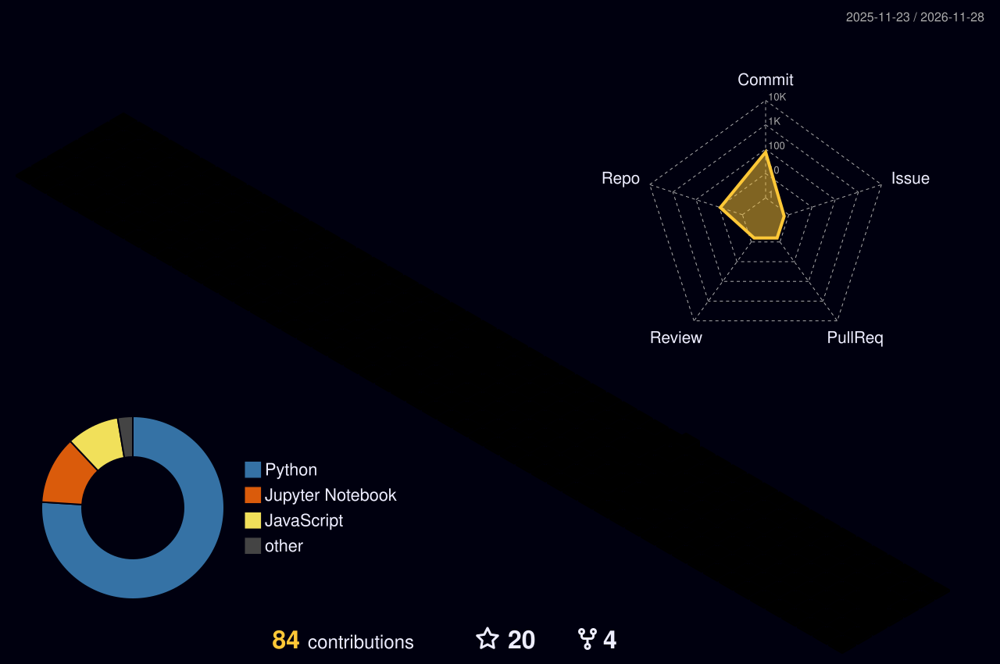

<div align="center">


<a href="https://github.com/Mohmed-Dyaa-Al-Arja"></a>

<p>
  <a href="https://www.linkedin.com/in/mohamed-dyaa-al-arja-9211ab309/"></a>
  <a href="https://v0-portfolio-5q.vercel.app/"></a>
  <a href="mailto:mohmeddyaa18@gmail.com"></a>
  <a href="https://github.com/Mohmed-Dyaa-Al-Arja?tab=followers"></a>
</p>


<br/><br/>
<b>Like what you see? Hit Follow and watch the projects grow.</b>

</div>

---

## About me

```python
class MohamedDyaa:
    role      = "Computer Science student @ Higher Technological Institute (HTI)"
    focus     = ["AI", "Data Science", "RAG & LLM apps", "Computer Vision"]
    based_in  = "Cairo, Egypt"
    learning  = ["Deep Learning", "Big Data", "LLM engineering"]
    open_to   = ["Internships", "Collaboration", "Cool AI ideas"]

    def say_hi(self):
        return "Let's build something intelligent together."
```

I build machine learning and AI applications, from classical models and forecasting to retrieval-augmented generation (RAG) systems.

## Featured projects

<div align="center">

<a href="https://github.com/Mohmed-Dyaa-Al-Arja/TERYaq"></a>
<a href="https://github.com/Mohmed-Dyaa-Al-Arja/RocketLeague_AI_Project"></a>
<br/>
<a href="https://github.com/Mohmed-Dyaa-Al-Arja/Mohmed-Dyaa-Al-Arja-Image-Processing-Effects"></a>
<a href="https://github.com/Mohmed-Dyaa-Al-Arja/rag-document-assistant"></a>

</div>

| Project | What it does | Stack |
| --- | --- | --- |
| [TERYaq](https://github.com/Mohmed-Dyaa-Al-Arja/TERYaq) | Multimodal clinical RAG for breast cancer: retrieval, visual evidence, reranking and safety checks | Python, RAG, LLMs |
| [rag-document-assistant](https://github.com/Mohmed-Dyaa-Al-Arja/rag-document-assistant) | Document Q&A with source citation and conversation memory | FastAPI, FAISS, LangChain, Gemini/Ollama |
| [Smart-Vehicle-Identifier](https://github.com/Mohmed-Dyaa-Al-Arja/Smart-Vehicle-Identifier) | AI vehicle recognition system built in the NTI Applied AI Engineering program | Python, Computer Vision |
| [sales-forecasting-project](https://github.com/Mohmed-Dyaa-Al-Arja/sales-forecasting-project) | End-to-end sales forecasting with notebooks, presentations and deployment files | Python, ML |
| [RocketLeague_AI_Project](https://github.com/Mohmed-Dyaa-Al-Arja/RocketLeague_AI_Project) | Rocket League bot combining search algorithms and reinforcement learning | Python, RL |
| [Image-Processing-Effects](https://github.com/Mohmed-Dyaa-Al-Arja/Mohmed-Dyaa-Al-Arja-Image-Processing-Effects) | OpenCV filters and effects with a Dash web app | OpenCV, Dash |
| [breast-cancer-diagnosis-app](https://github.com/Mohmed-Dyaa-Al-Arja/breast-cancer-diagnosis-app) | Streamlit diagnosis app with a Decision Tree classifier | Streamlit, scikit-learn |

More work: [heart-disease-prediction-app](https://github.com/Mohmed-Dyaa-Al-Arja/heart-disease-prediction-app), [loan-approval-prediction](https://github.com/Mohmed-Dyaa-Al-Arja/loan-approval-prediction), [Forest-Cover-Type-](https://github.com/Mohmed-Dyaa-Al-Arja/Forest-Cover-Type-), [music-genre-classification](https://github.com/Mohmed-Dyaa-Al-Arja/music-genre-classification), [tictactoe-ai-search-algorithms](https://github.com/Mohmed-Dyaa-Al-Arja/tictactoe-ai-search-algorithms).

## Tech stack

<div align="center">


</div>

## GitHub stats

<div align="center">


</div>

## Contribution activity

<div align="center">


</div>

## 3D contribution city

<div align="center">



</div>

## Trophies

<div align="center">


</div>

## Contribution snake

<div align="center">

<picture>
  <source media="(prefers-color-scheme: dark)" srcset="https://raw.githubusercontent.com/Mohmed-Dyaa-Al-Arja/Mohmed-Dyaa-Al-Arja/output/github-snake-dark.svg"/>
  
</picture>

</div>

## Dev quote of the moment

<div align="center">


</div>

## Currently

- Learning deep learning, machine learning and big data technologies
- Building RAG and LLM applications
- Open to internships and collaboration in AI and data science

<div align="center">

### Let's connect

<a href="https://www.linkedin.com/in/mohamed-dyaa-al-arja-9211ab309/"></a>
<a href="https://github.com/Mohmed-Dyaa-Al-Arja?tab=followers"></a>


</div>
